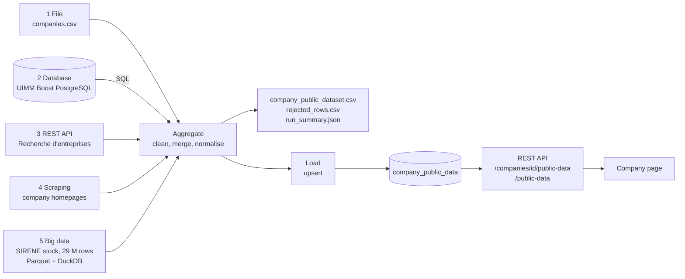
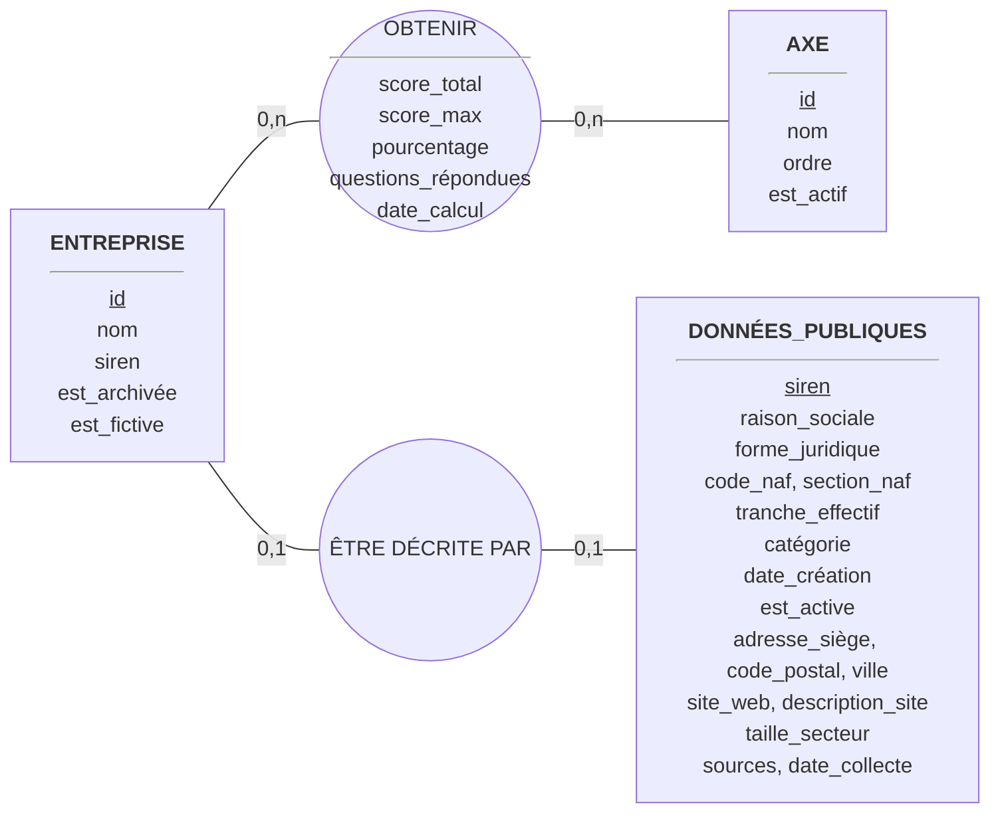

# Public-data pipeline

Consultants often know a company only by its name. This pipeline enriches the companies followed in UIMM Boost with **official public data** — legal name, activity code (NAF), headcount bracket, category, creation date, head office, activity status, website description, and the size of its sector in France — and stores it in PostgreSQL, where the application shows it on the company page.

The link between a company and its public data is the **SIREN**, the 9-digit French company identifier, typed by the consultant in the company form.



## Sources

| # | Type | Source | What it brings | Module |
|---|---|---|---|---|
| 1 | Data file | `companies.csv` prepared by the consultants (`siren`, `name`, `website`) | Which companies to enrich, their website | `extract_file.py` |
| 2 | Database | UIMM Boost PostgreSQL, hand-written SQL | Companies already followed, with their average diagnostic score | `extract_database.py` |
| 3 | REST API | [API Recherche d'entreprises](https://recherche-entreprises.api.gouv.fr) (data.gouv.fr, free, no key) | Daily-updated company record and head office address | `extract_api.py` |
| 4 | Scraping | The company's public homepage | A short description (meta description or title) | `extract_scraping.py` |
| 5 | Big data | [INSEE SIRENE stock of legal units](https://www.data.gouv.fr/fr/datasets/5b7ffc618b4c4169d30727e0/) — Parquet, about 29 million rows and 700 MB, updated monthly | Official record of each SIREN, and the number of active companies sharing its NAF code | `extract_bigdata.py` |

## Dependencies

Python 3.12 and the backend requirements (`pip install -r requirements.txt`), mainly:

| Package | Used for |
|---|---|
| `requests` | API calls, scraping, file download (with retries) |
| `beautifulsoup4` | Reading the HTML of homepages |
| `duckdb` | Querying the 700 MB Parquet file without loading it in memory |
| `SQLAlchemy`, `psycopg2-binary` | SQL extraction and import into PostgreSQL |

The database connection comes from `DATABASE_URL` in `Backend/.env`. Optional settings (environment variables): `PIPELINE_DATA_DIR`, `SIRENE_PARQUET_URL`, `COMPANY_API_DELAY`, `SCRAPING_DELAY` (see `config.py`).

## Run it

From the `Backend` folder, with the virtual environment active:

```bash
# Full run: the SIRENE file is downloaded once (about 700 MB) into pipeline_data/raw/
python -m app.pipeline.run --input app/pipeline/companies_example.csv

# Quick run without the big file, or without scraping, or without touching the database
python -m app.pipeline.run --input companies.csv --skip-bigdata --skip-scraping --no-load

# Reuse a SIRENE file you already downloaded
python -m app.pipeline.run --input companies.csv --sirene-file ~/Downloads/StockUniteLegale.parquet
```

Each run writes, in `Backend/pipeline_data/` (ignored by Git):

| File | Content |
|---|---|
| `output/company_public_dataset.csv` | The final dataset: one clean row per SIREN, with the sources used |
| `output/rejected_rows.csv` | Every rejected entry, with its source, line and reason |
| `output/run_summary.json` | Counts per source, errors, load result, duration |
| `logs/run_<date>.log` | The full log of the run |

The exit code is 0 when the run completes and 1 when it stops (in that case nothing is loaded).

## How the script works

`run.py` is the single launch point. In order:

1. **Initialisation** — logging to the console and a log file; settings from `config.py`.
2. **File** (required) — read the CSV; the delimiter (`,` or `;`) is detected, the `siren` column is mandatory. If the file is missing or malformed, the run stops.
3. **Database** — run the SQL below. If the database is unreachable, the error is logged and the run continues.
4. **REST API** — one GET per SIREN, with an identified User-Agent, a 15-second timeout, 3 retries with backoff on 429/5xx, and a 0.2 s pause (5 requests/second, under the API limit). Only the exact SIREN match is kept. The list of officers (`dirigeants`) is personal data and is never read.
5. **Big data** — the SIRENE file is downloaded once (to a `.part` file renamed only when complete), then DuckDB checks its columns and runs two queries: the official record of each wanted SIREN, and `COUNT(*) … GROUP BY` of active companies per NAF code over the 29 million rows.
6. **Scraping** — for each website: read `robots.txt` first and skip the site if it forbids access; then one GET of the homepage only, HTML only, 2 MB maximum, 1 s between sites; keep the meta description, else the title.
7. **Aggregation** — clean and merge (rules below).
8. **Save** — write the three output files.
9. **Load** — upsert into `company_public_data` in a single transaction.

**Errors.** A failing SIREN, website or source never stops the others: it is logged, listed in `run_summary.json` (`source_errors`), and the run continues with the data available. Only a missing input file or an unexpected error stops the run.

## Cleaning and normalisation rules (`aggregate.py`)

**Removed entries** (written to `rejected_rows.csv` with the reason):

| Problem | Rule |
|---|---|
| SIREN with spaces, dots or dashes | Cleaned, then checked |
| SIREN not made of 9 digits | Rejected |
| SIREN with a wrong checksum (Luhn) | Rejected — this catches most typing errors before any network call |
| SIREN present twice in the file | First line kept, the other rejected |
| SIREN unknown to the API and to SIRENE | Rejected |

**Merge.** Sources are joined on the SIREN, field by field. The API is updated daily and the SIRENE stock monthly, so the API value is kept and SIRENE fills the missing fields.

**Uniform formats.**

| Field | Format |
|---|---|
| SIREN | 9 digits, no spaces |
| NAF code | `NN.NNX` uppercase (`2562b` becomes `25.62B`), plus its section letter (C = manufacturing) |
| Headcount | 2-character INSEE code (`0` becomes `00`) plus its label, e.g. `21` = "50 à 99 salariés" |
| Dates | ISO dates (accepts `YYYY-MM-DD`, `YYYYMMDD`, `DD/MM/YYYY`) |
| Status | Boolean `is_active` (INSEE `A` = active) |
| Text | Trimmed, repeated spaces removed; website description cut at 500 characters |
| Website | `https://host/path`, host in lowercase |

## SQL extraction (`extract_database.py`)

```sql
SELECT c.id AS company_id, c.name AS company_name, c.siren,
       COUNT(s.id)             AS scored_axes,
       AVG(s.score_percentage) AS avg_score_percentage
FROM companies AS c
LEFT JOIN scores AS s
       ON s.company_id = c.id
      AND s.axis_id IN (SELECT a.id FROM axes AS a WHERE a.is_active = TRUE)
WHERE c.siren IS NOT NULL
  AND c.is_archived = FALSE
  AND c.is_synthetic = FALSE
GROUP BY c.id, c.name, c.siren
ORDER BY c.id;
```

| Choice | Why |
|---|---|
| Only 3 company columns selected | The contact name, e-mail and phone are personal data and are not needed |
| `LEFT JOIN` on scores | A company without any score yet is still enriched (`scored_axes = 0`) |
| Join condition on active axes | The retired Finance axis does not distort the average |
| `WHERE` on SIREN, archived and synthetic | Only real, current companies that can be linked to public data |
| `GROUP BY` on the company | One row per company, ready to merge with the other sources |

**Optimisations.** Two indexes are created at startup (`main.py`): `ix_companies_siren` for the filter and lookups on the SIREN, and `ix_scores_company_id` for the join. The query is plain SQL, so its plan can be checked in PostgreSQL:

```
EXPLAIN (ANALYZE) <query>
 Sort -> HashAggregate (Group Key: c.id) -> Hash Right Join (s.company_id = c.id)
   -> Hash Join (s.axis_id = a.id) -> Seq Scan on scores, Seq Scan on axes (Filter: is_active)
   -> Seq Scan on companies (Filter: siren IS NOT NULL AND NOT is_archived AND NOT is_synthetic)
 Execution Time: 0.145 ms
```

PostgreSQL rewrites the `IN (SELECT …)` as a hash join and groups on the primary key only. On tables of a few rows it prefers sequential scans; the indexes take over as the number of companies and scores grows.

**Big data queries (DuckDB).** The wanted SIRENs are loaded into a temporary table and joined to the Parquet file, so the 29 million rows are scanned once instead of once per SIREN. Parquet is columnar: each query reads only the columns it names, and DuckDB skips row groups that cannot match the filter. On a 3-million-row test file, the lookup and the sector count together took under a second.

## Data model (Merise)

### Conceptual model (MCD)

The pipeline uses three entities of UIMM Boost and adds one.



- An ENTREPRISE obtains 0 to n scores, at most one per AXE; an AXE is scored for 0 to n companies. OBTENIR carries the score attributes.
- An ENTREPRISE is described by 0 or 1 DONNÉES_PUBLIQUES (0 until the consultant enters its SIREN and the pipeline runs). DONNÉES_PUBLIQUES describe 0 or 1 ENTREPRISE (the pipeline may collect a SIREN before the company is created in the app).

### Physical model (MPD, PostgreSQL)

| Table | Column | Type | Constraint |
|---|---|---|---|
| **companies** | id | integer | PK |
| | name | varchar | NOT NULL |
| | siren | varchar(9) | NULL, index `ix_companies_siren` |
| | is_archived, is_synthetic | boolean | NOT NULL |
| **axes** | id | integer | PK |
| | name | varchar | NOT NULL |
| | order_index | integer | NOT NULL |
| | is_active | boolean | NOT NULL |
| **scores** | id | integer | PK |
| | company_id | integer | FK → companies.id, index `ix_scores_company_id` |
| | axis_id | integer | FK → axes.id |
| | score_total, score_max, answered_questions, total_questions | integer | NOT NULL |
| | score_percentage | double precision | NOT NULL |
| | calculated_at | timestamptz | default now() |
| **company_public_data** | id | integer | PK |
| | siren | varchar(9) | NOT NULL, UNIQUE, index |
| | legal_name, headcount_label, city, website, head_office_address | varchar | NULL |
| | legal_form_code | varchar(4) | NULL |
| | naf_code | varchar(6) | NULL, index |
| | naf_section | varchar(1) | NULL |
| | headcount_code | varchar(2) | NULL |
| | company_category | varchar(3) | NULL |
| | postal_code | varchar(5) | NULL |
| | creation_date | date | NULL |
| | is_active | boolean | NULL |
| | website_description | text | NULL |
| | sector_active_companies | integer | NULL |
| | sources | varchar | NOT NULL |
| | collected_at | timestamptz | NOT NULL, default now() |

The association ÊTRE DÉCRITE PAR is implemented by the shared SIREN value rather than a foreign key, because either side can exist without the other. The physical model is created by SQLAlchemy (`Base.metadata.create_all`) when the API starts; for databases created earlier, `main.py` adds the `siren` column and the two indexes with `IF NOT EXISTS`, so starting the API is enough to migrate.

**Why PostgreSQL.** The data is relational (companies, axes, scores), needs transactions for the import, and is already the application's database. DuckDB is used only as a query engine on the Parquet file, not as a second database.

## RGPD

| Topic | Choice |
|---|---|
| Purpose | Help UIMM Occitanie consultants prepare and contextualise company diagnostics |
| Data processed | Mostly company data (legal entities), which is not personal data |
| Personal data avoided | Officers (`dirigeants`) from the API are never read; contact name, e-mail and phone are not extracted by the SQL |
| Sole traders | Their company name and address are a person's name and home address: removed (legal form starting with 1) |
| Opposition to publication | Companies with INSEE status `P` (partial diffusion): name and address removed |
| Minimisation | Only the fields listed above are kept; homepages give one short description |
| Retention | Refreshed by each run (upsert); a record can be deleted when the company is no longer followed. The retention period is to be confirmed with UIMM's data protection contact. |
| Security | Data served only to authenticated consultants and admins (JWT); secrets in `.env`, never in Git |
| Sources and licence | data.gouv.fr and INSEE open data (Licence Ouverte 2.0) |

## Tests

```bash
python -m pytest tests/test_pipeline.py -q
```

The tests run offline: the API and websites are replaced by fakes, and the big-data tests build small Parquet files with the real SIRENE column names. They cover every source, the cleaning rules, the RGPD masking, the upsert, the API route, and a full end-to-end run.
