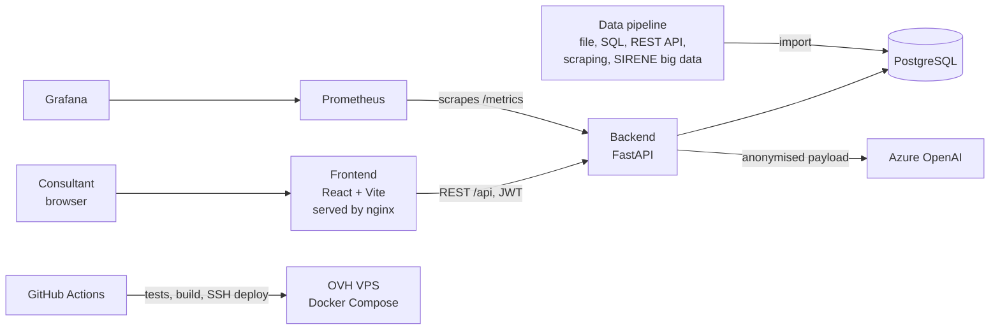

# UIMM Boost

UIMM Boost is a web application that helps the consultants of **UIMM Occitanie** (Service Développement Industriel) run a structured diagnostic of an industrial SME, and turn it into a SWOT analysis and a written report with the help of generative AI.

The consultant interviews the company, records the answers on six axes, and the application calculates a maturity score per axis. From these answers, **Azure OpenAI** drafts a SWOT and a diagnostic report. The consultant reviews and edits the drafts before validating them, and can export a PowerPoint presentation for the restitution meeting.

> Built from scratch by Khris during an internship at UIMM Occitanie (28 June – 19 November 2026), as part of the *Développeur en Intelligence Artificielle* certification (RNCP level 6, Simplon). An earlier version of the tool was built on the Microsoft Power Platform (Power Apps, Dataverse, Power Automate, Copilot Studio); this version replaces it with a full-code stack.

---

## Features

| Area | What the user can do |
|---|---|
| Companies | Create, edit, archive and restore the companies being diagnosed |
| Public data | Enter a company's SIREN and see its official public data (activity code, headcount, head office, sector size) collected by the data pipeline |
| Company profile | Fill in a profile questionnaire (activity, size, context) |
| Diagnostic | Answer the questionnaire on six axes: Stratégie, Performance, Marketing, RH, Digitalisation, RSE |
| Scores | Calculate a maturity score per axis and compare it with the average of archived diagnostics |
| AI SWOT | Generate a SWOT draft with Azure OpenAI, then edit and validate it |
| AI report | Generate a written diagnostic report draft, then edit it |
| PowerPoint | Export the restitution presentation |
| Administration | Manage users and roles, axes, questions, categories and profile questions |

Two roles exist: **consultant** (diagnostics, SWOT, reports) and **admin** (everything, plus administration).

---

## Architecture



| Layer | Technology |
|---|---|
| Frontend | React 18, Vite, React Router, Axios |
| Backend | Python 3.12, FastAPI, SQLAlchemy, Pydantic |
| Database | PostgreSQL 16 |
| AI | Azure OpenAI (Responses API) |
| Authentication | JWT (python-jose), Argon2 password hashing (pwdlib) |
| Data pipeline | requests, BeautifulSoup, DuckDB (Parquet) |
| Monitoring | JSON logs, Prometheus, Grafana |
| CI/CD | GitHub Actions, Docker, Docker Compose, OVH VPS |

### Repository layout

```
Backend/
  app/
    main.py              FastAPI application, middleware, routers
    routers/             REST endpoints (companies, answers, scores, swots, reports, admin…)
    models/              SQLAlchemy tables
    schemas/             Pydantic request/response models
    services/            business logic: scoring, AI payloads, Azure OpenAI, PowerPoint
    dependencies/        authentication and role checks
    monitoring.py        JSON logging and Prometheus metrics
    pipeline/            public-data pipeline: 5 sources -> clean dataset -> PostgreSQL
    setup_database.py    one-time setup: axes, scoring scales, first admin
  tests/                 pytest test suite
Frontend/
  src/pages/             one page per screen
  src/components/        shared components
  src/api/api.js         Axios client (adds the JWT to each request)
monitoring/              Prometheus, alert rules, Grafana (see monitoring/README.md)
.github/workflows/ci.yml CI/CD pipeline
compose.production.yml   production stack (db, backend, frontend)
```

---

## Run it locally

### Prerequisites

- Python 3.12
- Node.js 22
- Docker (for PostgreSQL, and optionally for monitoring)
- An Azure OpenAI resource with a deployed model (only needed for SWOT and report generation)

### 1. Start PostgreSQL

```bash
docker run -d --name uimm-db -p 5433:5432 \
  -e POSTGRES_DB=uimm_diagnostic_db \
  -e POSTGRES_USER=uimm_user \
  -e POSTGRES_PASSWORD=change-me \
  postgres:16
```

### 2. Configure and install the backend

```bash
cd Backend
cp .env.example .env          # then edit .env with your own values
python -m venv .venv
source .venv/bin/activate
pip install -r requirements.txt
```

### 3. Prepare the database (first time only)

This creates the tables, the six diagnostic axes with their scoring scales, and the first admin account. It is safe to run again: existing data is never changed.

```bash
ADMIN_USERNAME=admin@uimm.local ADMIN_PASSWORD='choose-a-long-password' python -m app.setup_database
```

The password must be at least 12 characters. It is read from the environment and only its Argon2 hash is stored.

### 4. Start the backend

```bash
uvicorn app.main:app --reload --host 0.0.0.0
```

The API runs on http://127.0.0.1:8000 and its interactive documentation on http://127.0.0.1:8000/docs.

### 5. Start the frontend

```bash
cd Frontend
npm ci
npm run dev
```

Open http://localhost:5173 and log in with the admin account. From the dashboard, the admin then creates the diagnostic questions (**Questions par axe**), the profile questions (**Profil de l’entreprise**) and the consultant accounts (**Utilisateurs**).

> The backend only accepts requests from `http://localhost:5173` (CORS). If Vite starts on another port because 5173 is busy, stop the other process first.

---

## Public-data pipeline

`Backend/app/pipeline/` collects official data about the companies from five sources — a CSV file, the UIMM Boost database (SQL), the government *API Recherche d'entreprises*, the companies' homepages (scraping) and the INSEE SIRENE stock (29 million rows, queried with DuckDB) — cleans and merges it, and imports it into the `company_public_data` table.

```bash
cd Backend
python -m app.pipeline.run --input app/pipeline/companies_example.csv
```

See [`Backend/app/pipeline/README.md`](Backend/app/pipeline/README.md) for the sources, cleaning rules, SQL, data model (Merise) and RGPD choices.

---

## Tests

```bash
cd Backend
pip install -r requirements-test.txt
python -m pytest tests -q
```

Tests run on an isolated in-memory SQLite database; they never touch your PostgreSQL data, and Azure OpenAI is replaced by a fake client, so no API key is needed.

---

## AI and personal data

- Before any call to Azure OpenAI, the company name, contact name, e-mail, phone number and address are **masked** in the text (`services/report_ai_payload.py`, `redact_text`). The AI receives "Entreprise anonymisée", never the real company.
- The AI only drafts. A consultant always reviews, edits and validates the SWOT and the report.
- Application logs contain technical data only (route, status, duration, token counts): no names, e-mails, passwords, tokens or prompt content.
- Secrets (database password, JWT key, Azure key) are read from environment variables and never committed.

---

## Monitoring

The backend writes one JSON log line per request and exposes Prometheus metrics on `/metrics`: request count and duration, Azure OpenAI calls by outcome, AI latency, token usage, and how often consultants edit AI drafts before validating them.

Prometheus and Grafana run with Docker Compose, with four alert rules (API down, server error rate above 5 %, repeated AI failures, slow AI calls). In production, nginx blocks `/api/metrics` so metrics are never public.

See [`monitoring/README.md`](monitoring/README.md) to start the tools and test an alert. The Grafana dashboard is versioned in `monitoring/grafana-dashboard.json`.

---

## CI/CD

The pipeline in `.github/workflows/ci.yml` runs on every push to `main` and `feature/finance-axis-years`, and on every pull request:

1. **Backend tests**: install dependencies, check Python syntax, run pytest with coverage (JUnit and coverage reports).
2. **Frontend build**: `npm ci` and `npm run build`.
3. **Deploy to OVH** (only after both jobs pass, on a push to the deployment branch): connect to the VPS over SSH with GitHub secrets, check out the exact commit, rebuild the Docker images, restart the stack with `compose.production.yml`, and run a health check on `/api/db-test`.

A broken commit therefore never reaches production.

### Production

`compose.production.yml` runs three containers: PostgreSQL (persistent volume), the FastAPI backend, and nginx serving the built frontend and proxying `/api` to the backend. Secrets come from `.env.production` on the server. On a new server, run the setup step once:

```bash
docker compose --env-file .env.production -f compose.production.yml exec \
  -e ADMIN_USERNAME=admin@uimm.local -e ADMIN_PASSWORD='choose-a-long-password' \
  backend python -m app.setup_database
```
